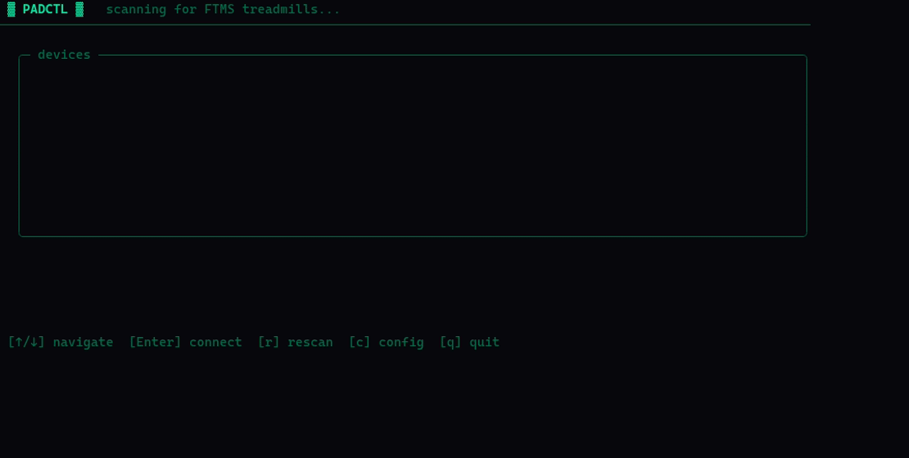

# padctl

> Terminal controller for KingSmith WalkingPad — BLE, cypherpunk green on black.



[](https://www.rust-lang.org/)
[](#install)
[](#supported-devices)

`padctl` is a single binary that finds your WalkingPad over Bluetooth, lets you start/pause/resume walks, watch live stats, and sync sessions to Google Fit — all from the terminal.

---

## Features

- **Auto-connect by name** — scans for your pad on startup, reconnects after BLE address rotation
- **Full FTMS protocol** — works with any treadmill advertising the Fitness Machine Service (UUID `0x1826`)
- **Session state machine** — clean Start → Pause → Resume → End transitions, stats accumulate across pauses
- **Live stats** — speed, distance, steps, time, calories updated on every BLE notification
- **Double-tap speed control** — single tap ±0.1 km/h, double-tap within 300 ms jumps ±0.5 km/h
- **Google Fit sync** — browser-based OAuth on first use, refresh token persisted for subsequent syncs
- **Persistent config** — `padctl.toml` in your working directory, device address auto-updated on reconnect
- **Debug logging** — `--debug` flag writes structured logs to stderr, TUI stays on stdout

---

## Supported Devices

Verified on **Kingfisher Z1 (KS-HD-Z1D)**.

Any treadmill that advertises the FTMS service (`0x1826`) with:
- **Treadmill Data** characteristic `0x2ACD` (notify)
- **Control Point** characteristic `0x2AD9` (write + indicate)

should work. The Kingfisher Z1 also exposes proprietary KingSmith characteristics (`0xfff1` / `0xfff2`) for step count — `padctl` uses them when present.

---

## Install

### Prerequisites

**Linux** — BlueZ and group membership:
```bash
sudo apt install bluez
sudo usermod -aG bluetooth $USER
# log out and back in for the group to take effect
```

**macOS** — CoreBluetooth is available out of the box. No extra steps.

### Build from source

Requires Rust 1.70+.

```bash
git clone <repo-url>
cd padctl
cargo build --release
./target/release/padctl
```

---

## Quick Start

1. Power on your WalkingPad
2. Run `padctl` — it scans and auto-connects by device name
3. Press **`s`** to start a session
4. **`↑`** / **`↓`** to adjust speed (double-tap for ±0.5 km/h jumps)
5. Press **`p`** to pause, **`r`** to resume, **`x`** to end the session

On first run with a new device: navigate the scan list with `↑`/`↓`, press `Enter` to connect. The device address is saved to `padctl.toml` for automatic reconnection next time.

---

## Controls

### Scanning

| Key | Action |
|-----|--------|
| `↑` / `k` | Cursor up |
| `↓` / `j` | Cursor down |
| `Enter` | Connect to selected device |
| `r` | Rescan |
| `c` | Open config dialog |
| `q` | Quit |

### Session

| Key | Action |
|-----|--------|
| `s` | Start (when idle) |
| `p` | Pause (when running) |
| `r` | Resume (when paused) |
| `x` | End session (when paused) |
| `↑` / `k` | Speed +0.1 km/h |
| `↓` / `j` | Speed −0.1 km/h |
| `↑↑` | Speed +0.5 km/h (double-tap within 300 ms) |
| `↓↓` | Speed −0.5 km/h (double-tap within 300 ms) |
| `h` | Jump to minimum speed (1.0 km/h) |
| `l` | Jump to maximum speed (6.0 km/h) |
| `c` | Config dialog |
| `q` | Quit |

### Session Summary

| Key | Action |
|-----|--------|
| `y` | Upload session to Google Fit |
| `n` / `x` | Discard without uploading |
| `q` | Quit |

### Config Dialog

| Key | Action |
|-----|--------|
| `Tab` / `↓` | Next field |
| `↑` | Previous field |
| `Enter` | Activate focused field |
| `Backspace` | Delete character (text fields) |
| `Esc` | Close dialog |

---

## CLI Flags

```
padctl [OPTIONS]

Options:
      --device-name <NAME>    Override saved device name
      --device-addr <ADDR>    Connect directly by MAC address (skips scan)
      --scan-timeout <SECS>   BLE scan timeout in seconds [default: 10]
      --debug                 Write debug log to stderr
  -h, --help                  Print help
```

**Capture debug output while TUI runs:**
```bash
padctl --debug 2>padctl-debug.log
tail -f padctl-debug.log   # in a second terminal
```

---

## Configuration

`padctl.toml` is created in your working directory on first connect.

```toml
device_addr   = "82:20:00:24:35:49"    # auto-updated after each connect
device_name   = "KS-HD-Z1D"            # name to scan for

# optional Google Fit OAuth credentials
fit_client_id     = ""
fit_client_secret = ""
fit_refresh_token = ""   # set automatically after first browser auth flow
```

The device address is re-saved every time `padctl` connects, so BLE address rotation (common on Kingfisher Z1 after power cycle) is handled transparently — reconnection falls back to name matching.

Override at runtime without editing the file:
```bash
padctl --device-name "WalkingPad"
padctl --device-addr AA:BB:CC:DD:EE:FF
```

---

## Google Fit

1. Go to [Google Cloud Console](https://console.cloud.google.com/) → APIs & Services → Credentials
2. Create an **OAuth 2.0 Client ID** (type: Desktop app)
3. Add `http://localhost` as an authorized redirect URI (any port)
4. Copy the **Client ID** and **Client Secret**
5. Press `c` in `padctl` → enter Client ID → enter Client Secret → navigate to **Save** → `Enter`
6. After your next session, press `y` on the summary screen — a browser tab opens for consent
7. The refresh token is stored in `padctl.toml`; subsequent syncs happen without a browser prompt

Data uploaded per session: steps, distance (meters), calories (kcal), session start/end time, activity type = Treadmill.

---

## Troubleshooting

**Scan finds nothing**
- Make sure the WalkingPad is powered on and not connected to another device (phone app, remote)
- Try a longer scan: `padctl --scan-timeout 20`
- Verify BlueZ is running: `systemctl status bluetooth`

**"Permission denied" on Linux**
- Add yourself to the `bluetooth` group: `sudo usermod -aG bluetooth $USER` then re-login
- Or run once with `sudo padctl` to verify BLE access works, then fix the group

**Address rotates after power cycle**
- `padctl` saves the device **name** and re-matches by name — this is handled automatically
- If auto-match fails, press `r` to rescan; the new address is saved on connect

**GATT setup fails or disconnects immediately**
- Run with `--debug` and check `padctl-debug.log` for characteristic discovery errors
- Some devices require a delay before GATT operations after connect — the log will show where it fails

**"RequestControl failed"**
- Another client may hold FTMS control; disconnect the official app and retry

---

## Architecture

```
src/
├── main.rs          # tokio event loop, keyboard dispatch, BLE session task
├── types.rs         # BleEvent, Cmd, DiscoveredDevice
├── config.rs        # padctl.toml — serde + toml, device address persistence
├── error.rs         # AppError with thiserror
├── logger.rs        # stderr debug logging (--debug flag)
├── fit.rs           # Google Fit: OAuth 2.0 loopback + REST dataset upload
├── ble/
│   ├── protocol.rs  # FTMS + KingSmith proprietary packet codec, 66 unit tests
│   ├── scanner.rs   # btleplug scan, GATT discovery, notification stream
│   └── traits.rs    # WalkingPadBle async trait (enables mocking in tests)
├── session/
│   ├── mod.rs       # state machine: Idle → Running ↔ Paused → Idle
│   └── stats.rs     # cumulative stat accumulator, device counter reset handling
└── ui/
    ├── app.rs       # AppState, AppMode, double-tap timing, animation state
    └── render.rs    # ratatui: animated braille disc, stats panel, speed gauge, log
```

**Key design decisions:**
- All I/O on a single tokio runtime; BLE events and key events flow through `mpsc` channels
- Render is a pure read of `AppState` — no locks held during draw
- Stats use `saturating_sub` to survive device counter resets mid-session
- OAuth uses a TCP loopback listener on a random port — no external server needed

---

## Demo

The demo GIF was recorded with [VHS](https://github.com/charmbracelet/vhs). To regenerate it:

```bash
vhs padctl.tape
```

The tape file (`padctl.tape`) and the simulation script (`demo/padctl-demo.sh`) are both in the repository.

---

## License

MIT
